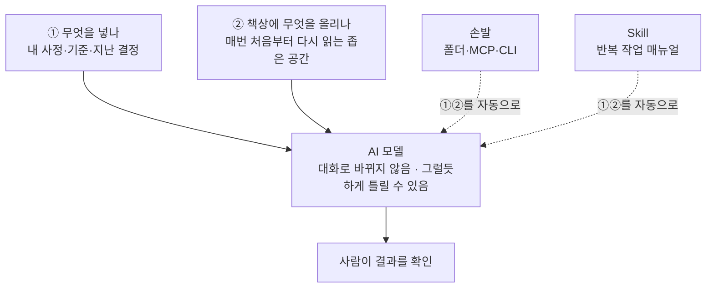

# AI01 — AI가 일하는 방식 이해하기

## 이 스텝에서 하는 일

방금 [[06_AI00-지식베이스-깔고-AI와-연결하기]]에서 기록 하나가 AI의 답을 바꾸는 걸 봤습니다. 이번에는 **왜 그런지**와 **AI로 무엇을 할 수 있고 무엇은 못 하는지**를 한 장의 지도로 익힙니다. 이어지는 스텝은 이 지도의 칸을 하나씩 직접 해 보는 실습이고, 마지막 스텝에서 이 지도로 내 일의 자동화 후보를 고릅니다.

`⭐ 쉬움 · 약 25분 · 코드 없음`

## AI를 쓸 때 사람이 움직이는 레버는 둘뿐입니다



1. **AI는 내 일을 모릅니다.** 세상 어디에도 안 적힌 내 사정·기준·지난 결정은 검색해도 안 나옵니다. 그래서 아무것도 안 주면 누구에게나 맞는 일반론이 나옵니다. 지식베이스에 적어 두면 읽고 답합니다. AI00에서 본 차이가 이것입니다.
2. **AI는 기억하지 않고 매번 다시 읽습니다.** 대화가 이어지는 것처럼 보여도, AI는 매번 대화 전체를 처음부터 다시 읽고 답합니다. 그 책상은 좁아서 대화가 길어지면 앞에서 정한 것이 밀려납니다. 그래서 정한 것은 대화가 아니라 **파일**에 남기고, 한 가지 일이 끝나면 새 대화를 엽니다.

이 둘을 바꿀 수 없는 전제도 알아 둡니다.

- **모델은 대화로 바뀌지 않습니다.** 오늘 가르친 내용이 모델 안에 남지 않습니다. 남는 건 내 파일뿐입니다.
- **AI는 그럴듯한 말을 이어 가는 방식이라 자신 있게 틀립니다.** 결과는 마지막에 사람이 눈으로 확인합니다.

**손발**(파일·브라우저·업무 서비스에 닿는 도구)과 **Skill**(반복 작업 매뉴얼)은 새 레버가 아닙니다. ①②를 사람이 매번 하지 않도록 자동으로 해 주는 장치입니다. 실습은 [[10_AI04-AI에게-도구로-손발-달아주기]], [[11_AI05-반복작업을-Skill로-만들기]]에서 합니다.

## AI가 못 한다고 느낄 때는 원인이 셋입니다

| 원인 | 판별 | 처방 |
| --- | --- | --- |
| **손이 없어서** | 아무나 그 파일·화면을 열면 알 수 있다 | 도구를 붙인다 |
| **몰라서** | 내 머릿속이나 우리 팀 안에만 있다 | 내 기준을 꺼내 파일로 적는다 |
| **구조적으로 못 해서** | 정확한 계산, 스스로 틀린 줄 알기, 내 취향 판단 | 사람이 하거나 확인 절차를 붙인다 |

결과가 나쁘면 "AI가 멍청해서"라고 결론 내기 전에 **재료를 안 줬나 → 책상이 어질러졌나 → 확인 없이 믿었나** 순서로 의심합니다. 대개 첫 번째에서 끝납니다. 상황별 처방은 [[01_AI가-못하는-것-무엇을-쥐여줄까]]에 모아 두었습니다.

## 직접 확인해 봅니다

설명을 듣는 것보다 한 번 보는 게 빠릅니다. 코치와 아래 셋을 해 봅니다.

1. **모른다:** AI00에서 채운 파일의 질문을 웹 ChatGPT·Claude 같은 빈 대화에도 똑같이 합니다. 지식베이스 폴더에서 받은 답과 나란히 놓고, 무엇이 달라졌는지 한 줄로 말합니다.
2. **손발:** 코치에게 "지금 너한테 붙은 도구가 뭐야?"라고 묻고, 각각 무엇을 할 수 있는지 쉬운 말로 듣습니다.
3. **진단:** 예전에 AI에게 시켰다가 실망한 일 하나를 꺼냅니다. 위 표의 세 원인 중 무엇인지 내가 먼저 말하고, 코치의 판단과 비교합니다.

## 코치에게 줄 말

```text
AI00에서 채운 파일을 근거로 답할 때와 아무것도 안 읽고 답할 때의 차이를 보여줘.
지금 너한테 붙은 도구를 쉬운 말로 목록으로 알려줘.
예전에 AI에게 [이 일]을 시켰다가 실망했어. 내가 먼저 원인을 말할 테니,
손이 없어서 / 몰라서 / 구조적으로 못 해서 중 무엇인지 네 판단과 이유를 말하고,
그럼 내가 무엇을 주면 되는지 알려줘.
```

## 완료 기준

- 기록이 있을 때와 없을 때 AI 답이 어떻게 다른지 내 말로 한 줄 설명했습니다.
- "정한 건 대화가 아니라 파일에 남기고, 일이 끝나면 새 대화를 연다"를 왜 하는지 말할 수 있습니다.
- 실망했던 일 하나를 세 원인 중 하나로 진단하고, 무엇을 주면 되는지 정했습니다.

다음: [[08_AI02-AI가-모르는-암묵지-주입하기]]. 지도의 "① 무엇을 넣나"를 직접 해 봅니다.
