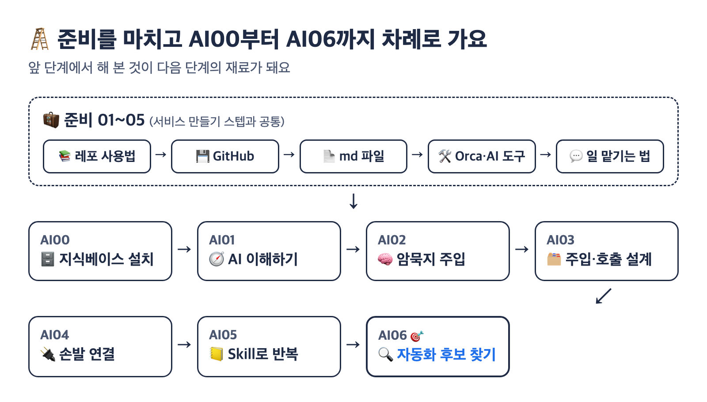

> **핵심 한 문장:** AI를 잘 쓴다는 건 **내 일의 순서와 기준을 파일로 남겨, AI가 매번 그걸 읽고 일하게 하는 것**입니다. 기준은 AI가 그 일을 잘하는 사람에게서 찾아오고, 내 사정은 내가 더하고, 결과가 틀리면 고칩니다.
>
> **결과:** 코드 읽기가 아니라, 내 일 하나를 이 방식으로 AI에게 맡기고 다음에도 반복하게 만드는 것입니다. 만들고 싶은 결과물이 아직 없다면 노트북 고르기·여행 계획처럼 당장 할 생활 속 일 하나로 시작합니다.

## 전체 흐름

그림 원본(mermaid)

준비(01~05)는 서비스 만들기 스텝에도 필요한 공통 기반입니다. 웹앱을 만들고 싶다면 준비까지 마친 뒤 [서비스 만들기 스텝](../02_서비스_만들기/_index.md)으로 가도 됩니다.

| # | 모듈 | 끝나면 생기는 것 |
| --- | --- | --- |
| AI00 | [[06_AI00-지식베이스-깔고-AI와-연결하기]] | AI가 새 대화에서도 찾아 읽는 내 지식 폴더 |
| AI01 | [[07_AI01-AI가-일하는-방식-이해하기]] | AI가 못 하는 일을 손·지식·구조로 가르는 눈 |
| AI02 | [[08_AI02-AI가-모르는-암묵지-주입하기]] | 잘하는 사람의 기준 위에 내 기준·결정 이유·실패를 더한 판단 재료 |
| AI03 | [[09_AI03-주입할-것과-읽힐-때-설계하기]] | 넣을 것·뺄 것·읽힐 때가 정해진 컨텍스트 구조 |
| AI04 | [[10_AI04-AI에게-도구로-손발-달아주기]] | 파일·브라우저·업무 서비스 중 실제 연결 하나 |
| AI05 | [[11_AI05-반복작업을-Skill로-만들기]] | 다음 사례에도 재사용되는 반복 작업 매뉴얼 |
| AI06 | [[12_AI06-내-일에서-자동화-후보-찾기]] | 입력·결과·위험이 정해진 첫 자동화 후보 |

수업 자료 PDF: `13_AI-스텝-수업자료.pdf` (GitHub 준비 + AI00~AI06)

## 순서는 길이 아니라 의존 관계입니다

AI00부터 AI06까지 순서대로 갑니다. 지식베이스를 깔고 AI를 이해한 뒤 암묵지·주입 설계·손발·Skill을 하나씩 해 보고, 마지막에 내 일에서 자동화 후보를 찾아 배운 방법을 적용합니다. 후보를 실행하다 막히면 아래 표로 돌아갑니다.

| 지금 막힌 이유 | 갈 곳 |
| --- | --- |
| AI가 내 사정과 기준을 모른다 | AI02 암묵지 |
| 무엇을 기록하고 언제 읽힐지 모르겠다 | AI03 주입·호출 설계 |
| 파일·화면·서비스를 직접 못 만진다 | AI04 손발 |
| 매번 같은 설명과 순서를 반복한다 | AI05 Skill |

<!-- folder-index:auto:start -->
> 상위 지도: [가장 가까운 상위 `_index.md`](../_index.md)

## 자동 생성 문서 목록

> 이 폴더가 직접 소유한 Markdown 문서를 YAML 메타데이터로 색인한다. 하위 폴더 문서는 각 폴더의 `_index.md`가 소유한다.

| 문서 | 요약 | 상태·주의 |
| --- | --- | --- |
| [이 레포를 쓰는 법](01_%EC%9D%B4-%EB%A0%88%ED%8F%AC%EB%A5%BC-%EC%93%B0%EB%8A%94-%EB%B2%95.md) | 이 레포는 AI 코치와 함께 만드는 워크북 — 핵심 루프, 코치가 상태 파일을 읽고 이끄는 방식, 세션 시작 멘트, 템플릿·레퍼런스 폴더 안내 | — |
| [GitHub로 체크포인트와 동기화 만들기](02_GitHub%EB%A1%9C-%EC%B2%B4%ED%81%AC%ED%8F%AC%EC%9D%B8%ED%8A%B8%EC%99%80-%EB%8F%99%EA%B8%B0%ED%99%94-%EB%A7%8C%EB%93%A4%EA%B8%B0.md) | GitHub를 개발자용 구글 드라이브이자 작업 타임머신으로 준비하고, commit 체크포인트와 push·pull·clone으로 어느 컴퓨터에서든 안전하게 이어 일하는 법 | — |
| [AI는 md 파일이 편하다](03_AI%EB%8A%94-md-%ED%8C%8C%EC%9D%BC%EC%9D%B4-%ED%8E%B8%ED%95%98%EB%8B%A4.md) | md(마크다운)는 #·** 같은 기호로 제목과 강조를 표시한 글자만 든 문서라, AI가 변환 없이 읽고 직접 고치고 필요한 부분만 찾아 읽을 수 있어 지식베이스를 한글·워드가 아닌 md로 쓰는 이유를 원본과 뷰어 화면 비교로 익히는 공통 준비 문서 | — |
| [Orca와 AI 도구 설치하기](04_AI-%EB%8F%84%EA%B5%AC-%EA%B3%A0%EB%A5%B4%EA%B3%A0-CLI-%EC%84%A4%EC%B9%98%ED%95%98%EA%B8%B0.md) | 비개발자가 Orca를 공통 작업 화면으로 설치하고 Codex CLI나 Claude Code 하나를 연결해 로컬 폴더를 읽히는 운영체제별 준비 단계 | — |
| [AI에게 일 맡기는 프롬프트 쓰는 법](05_AI%EC%97%90%EA%B2%8C-%EC%9D%BC-%EB%A7%A1%EA%B8%B0%EB%8A%94-%ED%94%84%EB%A1%AC%ED%94%84%ED%8A%B8-%EC%93%B0%EB%8A%94-%EB%B2%95.md) | 생각의 주도권은 사람이 쥐고 AI에게 문장 다듬기·되묻기·자료 찾기를 맡기며, 결과·재료·완성 형태·지킬 선·확인 방법만 골라 주는 공통 작업 의뢰법 | — |
| [AI00 — 지식베이스 깔고 AI와 연결하기](06_AI00-%EC%A7%80%EC%8B%9D%EB%B2%A0%EC%9D%B4%EC%8A%A4-%EA%B9%94%EA%B3%A0-AI%EC%99%80-%EC%97%B0%EA%B2%B0%ED%95%98%EA%B8%B0.md) | 생활백서·돈을 포함한 기본 지식베이스에서 필요한 파일 하나를 채우고, 새 대화에서도 그 기록을 근거로 답하게 하는 첫 실습이다. | — |
| [AI01 — AI가 일하는 방식 이해하기](07_AI01-AI%EA%B0%80-%EC%9D%BC%ED%95%98%EB%8A%94-%EB%B0%A9%EC%8B%9D-%EC%9D%B4%ED%95%B4%ED%95%98%EA%B8%B0.md) | 지식베이스를 깐 직후, AI가 내 일을 모르는 이유(주입)·기억하지 않고 매번 다시 읽는 구조(컨텍스트)·못 바꾸는 전제·손발과 Skill을 한 장의 지도로 익히고, 예전에 실망한 일 하나를 손·지식·구조 중 어느 문제인지 진단해, 이어지는 실습과 마지막 자동화 후보 찾기의 지도로 쓰는 모듈 | — |
| [AI02 — AI가 모르는 암묵지 주입하기](08_AI02-AI%EA%B0%80-%EB%AA%A8%EB%A5%B4%EB%8A%94-%EC%95%94%EB%AC%B5%EC%A7%80-%EC%A3%BC%EC%9E%85%ED%95%98%EA%B8%B0.md) | 그 일을 잘하는 사람·단체의 순서와 기준을 출처와 함께 조사해 초안을 만들고, AI가 검색으로 알 수 없는 내 기준·과거 결정의 이유·실패·선호를 질문으로 꺼내 더한 뒤 기존 지식 노트에 병합해 다음 작업의 판단 재료로 쓰이게 만드는 모듈 | — |
| [AI03 — 주입할 것과 읽힐 때 설계하기](09_AI03-%EC%A3%BC%EC%9E%85%ED%95%A0-%EA%B2%83%EA%B3%BC-%EC%9D%BD%ED%9E%90-%EB%95%8C-%EC%84%A4%EA%B3%84%ED%95%98%EA%B8%B0.md) | 파일 관리는 곧 컨텍스트 관리라는 원리로 무엇을 기록하고 뺄지, 규칙·지식·작업 문서 어디에 둘지, AI가 언제 읽을지를 함께 설계하는 모듈 | — |
| [AI04 — AI에게 도구로 손발 달아주기](10_AI04-AI%EC%97%90%EA%B2%8C-%EB%8F%84%EA%B5%AC%EB%A1%9C-%EC%86%90%EB%B0%9C-%EB%8B%AC%EC%95%84%EC%A3%BC%EA%B8%B0.md) | AI가 모바일 시뮬레이터·브라우저·외부 서비스에 직접 접근하게 하고, 모바일 클라우드와 로컬 도구 중 상황에 맞는 손발을 골라 실제 작업까지 맡기는 모듈 | — |
| [AI05 — 반복 작업을 Skill로 만들기](11_AI05-%EB%B0%98%EB%B3%B5%EC%9E%91%EC%97%85%EC%9D%84-Skill%EB%A1%9C-%EB%A7%8C%EB%93%A4%EA%B8%B0.md) | 성공해 절차가 정해진 일을 매번 다시 설명하기 귀찮아졌을 때 시작 조건·입력·절차·결과·검증을 Skill로 묶어 새 사례에서 재사용하는 모듈 | — |
| [AI06 — 내 일에서 자동화 후보 찾기](12_AI06-%EB%82%B4-%EC%9D%BC%EC%97%90%EC%84%9C-%EC%9E%90%EB%8F%99%ED%99%94-%ED%9B%84%EB%B3%B4-%EC%B0%BE%EA%B8%B0.md) | 기억 대신 AI 대화 기록·다운로드 폴더·보낸 메일 같은 작업 흔적과 최근 결과물 역질문·이번 주 할 일 같이 하기로 반복 업무를 찾고, 앞 스텝에서 익힌 암묵지·주입 설계·손발·Skill로 후보마다 무엇이 필요한지 정해 첫 자동화를 고르는 마지막 모듈 | — |
<!-- folder-index:auto:end -->
