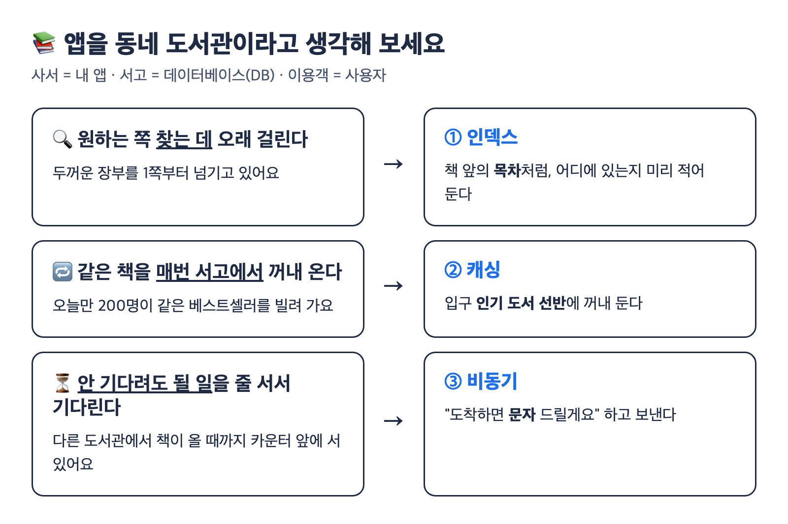
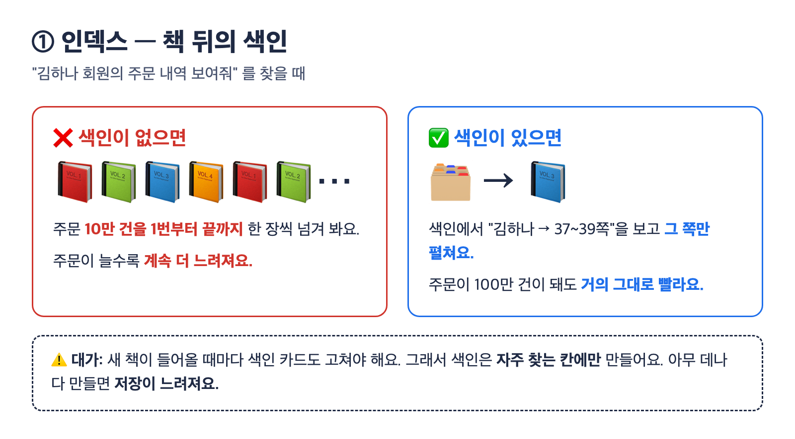
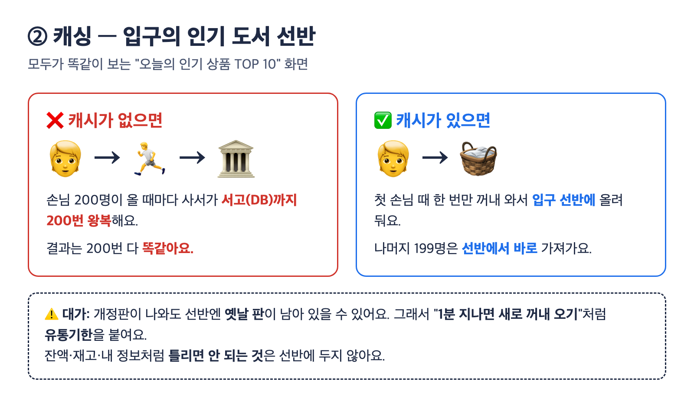
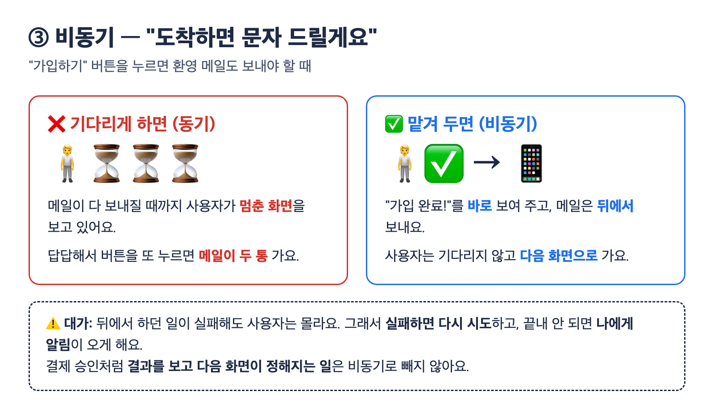

## 이 스텝에서 하는 일 (한 줄)
앱이 느려졌을 때 **어디서 기다리는지** 찾고, 그 자리에 맞는 처방 하나를 고릅니다.

`⭐⭐ 보통 · 🕐 약 30분`

## 앱을 도서관이라고 생각해 보세요



느린 이유는 대부분 이 셋 중 하나예요. 처방이 이유마다 다르니 **증상부터 맞춰 보세요.**

| 이런 증상이면 | 처방 | 도서관에서는 |
|---|---|---|
| 데이터가 쌓일수록 목록과 검색이 **점점** 느려진다 | **인덱스** | 책 뒤의 색인 |
| 모두가 같은 화면을 보는데 **사람이 몰리면** 느려진다 | **캐싱** | 입구 인기 도서 선반 |
| 버튼을 누르면 **몇 초씩 화면이 멈춘다** | **비동기** | "도착하면 문자 드릴게요" |

## 먼저 어디서 느린지 잰다

감으로 고치면 엉뚱한 곳을 손대요. 코치에게 **단계마다 몇 초 걸리는지** 재 달라고 하고 고친 뒤 같은 방법으로 다시 재서 숫자로 비교합니다.

```
[화면 이름] 화면이 느려. 고치기 전에 먼저 어디서 느린지 재줘.
- DB 조회, 외부 서비스 호출(메일·AI 등), 화면 그리기가 각각 몇 초 걸리는지 표로 보여줘.
- 가장 오래 걸리는 곳이 인덱스·캐싱·비동기 중 어느 문제인지 쉬운 말로 짚어줘.
- 아직 고치지는 마.
```

## ① 찾는 게 느리면 인덱스



DB(데이터베이스, 앱의 데이터 창고)는 따로 말하지 않으면 첫 줄부터 한 줄씩 넘기며 찾아요. 데이터가 적을 땐 티가 안 나다가, 쌓일수록 느려져요. 인덱스는 **값마다 어디에 있는지 적은 목록을 미리 만들어 두는 것**이에요.

- **이럴 때 써요:** 자주 거르는 칸(회원 아이디, 날짜, 카테고리)과 자주 정렬하는 칸.
- **대가:** 저장할 때마다 색인도 고쳐야 해서 **저장이 조금 느려져요.** 실제로 느린 검색에만 다세요.
- Supabase를 쓴다면 **Index Advisor**가 느린 조회에 맞는 인덱스를 추천해 줘요.

```
[화면 이름]의 조회가 느려. 이 조회에 인덱스가 필요한지 봐줘.
- Supabase Index Advisor나 실행 계획(EXPLAIN)으로 확인하고, 실제로 느린 조회에만 인덱스를 달아줘.
- 어떤 칸에 왜 달았는지, 저장 속도에는 어떤 영향이 있는지 한 줄씩 알려줘.
- 단 뒤에 같은 조회 시간을 다시 재서 전·후를 비교해줘.
```

## ② 같은 걸 매번 다시 가져오면 캐싱



캐시(cache)는 **한 번 가져온 결과를 가까운 곳에 잠깐 두는 것**이에요. 다음 사람은 멀리 가지 않고 바로 가져가요.

- **이럴 때 써요:** 모두에게 똑같이 보이고 조금 늦게 바뀌어도 괜찮은 화면. 공지, 인기 목록, 상품 설명 같은 것.
- **대가:** 선반의 책이 옛날 판일 수 있어요. 그래서 "1분 지나면 새로 가져오기"처럼 **유통기한**(전문용어로 TTL)을 붙여요.
- **두면 안 되는 것:** 잔액, 재고, 로그인한 사람만 보는 내 정보. 틀린 숫자가 보이거나, **남의 정보가 다른 사람에게 보일 수 있어요.**

```
[화면 이름]은 모든 사용자에게 똑같이 보이고 1분쯤 늦게 바뀌어도 괜찮아. 이 화면에 캐시를 붙여줘.
- 유통기한은 1분으로 해줘.
- 로그인한 사람마다 다른 정보, 잔액, 재고는 캐시하지 마.
- 붙인 뒤 응답 시간을 다시 재서 전·후를 비교해줘.
```

## ③ 안 기다려도 될 일을 기다리면 비동기



동기는 **"끝날 때까지 기다렸다가 다음"**, 비동기는 **"맡겨 두고 먼저 다음"**이에요.

- **이럴 때 써요:** 사용자가 결과를 바로 볼 필요 없는 일. 환영 메일, 알림 보내기, 사진 크기 줄이기, AI 요약처럼 오래 걸리는 일.
- **대가:** 뒤에서 실패해도 사용자는 몰라요. **다시 시도**와 **나에게 오는 실패 알림**을 같이 만들어요.
- **빼면 안 되는 것:** 결제 승인, 로그인처럼 결과를 보고 다음 화면이 정해지는 일.

```
[버튼 이름]을 누르면 [메일 보내기 같은 오래 걸리는 일] 때문에 화면이 멈춰. 이 일을 뒤에서 하게 바꿔줘.
- 사용자에게는 "완료"를 바로 보여줘.
- 뒤에서 하던 일이 실패하면 몇 번 다시 시도하고, 끝내 실패하면 나한테 알림이 오게 해줘.
- 버튼을 여러 번 눌러도 한 번만 처리되게 해줘.
```

## ✅ 여기까지 하면 이렇게 보여요

- 느린 화면 하나를 골라 **고치기 전과 후의 시간을 숫자로** 비교했어요.
- 그 화면이 셋 중 어느 이유였는지 도서관 비유로 설명할 수 있어요.
- **안 되면:** 빨간 글씨가 뜨면 전문을 그대로 코치에게. → [[10_스텝09-막혔을때-에러-읽고-디버깅]]

## ⚠️ 자주 하는 실수

- **재지 않고 셋 다 한꺼번에 붙인다.** 무엇이 효과였는지 모르고 대가만 셋이 쌓여요. 하나 고치고, 재고, 다음.
- **모든 칸에 인덱스를 단다.** 저장이 느려져요.
- **내 정보 화면을 캐시한다.** 옛 정보나 남의 정보가 보여요.
- **비동기로 빼고 실패 알림을 안 만든다.** 메일이 안 가도 아무도 몰라요.

## 다음 스텝

- 느린 원인이 N+1 조회, 큰 이미지, 한꺼번에 불러오기라면 [[08_제품08-비용-성능-모바일]]
- 고친 뒤 다시 느려지는지 지켜보려면 [[04_제품04-안-무너지게-테스트-모니터링-백업]]
- 모르는 단어는 [[02_용어집-비개발자용]]
