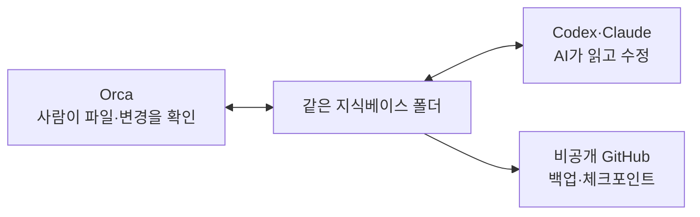

## 이 스텝에서 하는 일

공통 준비에서 설치한 Orca, Codex CLI 또는 Claude Code, GitHub 위에 **내 지식베이스를 설치**합니다. 폴더 구조를 공부하는 게 목표가 아니라, 내 기록 하나가 다음 답에 실제로 쓰이는 경험이 목표입니다.

`⭐ 쉬움 · 약 30분 · 설치와 명령은 코치가 처리`

## 왜 대화창이 아니라 지식베이스인가요?

웹 채팅의 메모리는 플랫폼이 갖고, 결과는 내가 복사해 옮겨야 남습니다. 지식베이스는 맥락을 **내 폴더**에 두고, AI가 일하면서 결과와 배운 것을 **그 폴더에 직접 씁니다.** 그래서 쓸수록 쌓이고, AI를 바꿔도 남습니다.


AI가 복사·붙여넣기 없이 직접 실행하고 검증하게 하는 손발은 [[AI04-AI에게-도구로-손발-달아주기]]에서 답니다.

## 코치가 대신 해주는 설치

1. `02_템플릿/01_지식베이스-템플릿/`을 내 작업 폴더에 복사합니다.
2. AI가 먼저 읽는 규칙 파일과 `index.md`가 있는지 확인합니다.
3. ChatGPT·Claude를 써 왔다면 설정의 데이터 내보내기로 받은 대화 기록을 지식베이스에 통째로 넣습니다. 첫날부터 내 맥락이 들어 있는 상태로 시작하고, [[AI00-내-일에서-자동화-후보-찾기]]의 반복 요청 찾기에도 씁니다. 원본은 너무 커서 AI가 다 읽지 못하므로 반복 요청과 고쳐 준 기준만 노트로 뽑고, 원본은 내담자·고객 정보처럼 민감한 내용이 있으면 GitHub 업로드에서 뺍니다. 써 본 적이 없다면 이 단계는 건너뜁니다.
4. 공통 준비에서 익힌 방식으로 **이 지식베이스용 비공개 GitHub 저장소**를 만들고 첫 체크포인트를 올립니다. 내 답은 이 복사본에만 쓰고 비밀번호·인증키는 기록하지 않습니다.
5. Orca의 **Add Repo**에서 같은 지식베이스 루트를 고르고 파일 목록의 `index.md`를 엽니다.
6. 저장소 옆 `+`에서 설치한 Codex 또는 Claude Code를 골라 실행합니다. **로컬 파일은 MCP 없이 작업 폴더만 연결하면 읽을 수 있습니다.**
7. 코치가 기본 폴더를 보여주고 오늘 기록할 주제 하나를 묻습니다. 분야 일을 고르면 인터뷰로 `02_내-분야/`를 내 분야 이름으로 바꾸고 그 안 `CLAUDE.md`를 채웁니다. 생활백서·돈부터 시작해도 됩니다.



기본 폴더는 **나·내 분야·생활백서·돈**입니다. 생활백서와 돈에는 답할 질문이 있는 파일을 미리 넣었습니다. 파일별 목록은 [[지식베이스-스타터]]에서 볼 수 있습니다. 루트 `CLAUDE.md`는 노트를 쌓는 규칙, 분야 폴더 `CLAUDE.md`는 그 분야 일을 하는 규칙입니다. 하위 폴더는 실제 기록이 쌓여 찾기 어려울 때 [[지식베이스-폴더분류-어떻게-나눌까]]를 보고 나눕니다.

## 기존 자료 가져오기 — 원본만, 폴더 하나부터

구글 드라이브·원드라이브·카카오톡 받은 파일에 몇 년치 자료가 있어도 **통째로 넣지 않습니다.** 많이 넣으면 AI가 더 똑똑해지는 게 아니라 뭐가 중요한지 몰라지고, 사용량 한도만 찹니다.

| 기준 | 넣는다 | 넣지 않는다 |
| --- | --- | --- |
| 원본인가 | 캘린더 원본, 견적서 원본, 고객 응대 기록 | 내가 그걸 요약·통계 낸 가공본 (원본에서 다시 만들 수 있음) |
| 지금 일에 쓰이나 | [[AI00-내-일에서-자동화-후보-찾기]]에서 고른 일의 폴더 하나 | "나중에 쓸지도 모르는" 나머지 |
| 이미 로컬에 있나 | 없으면 코치가 MCP·CLI로 가져옴 | 구글 드라이브 데스크톱 동기화 폴더처럼 **이미 있는 건 그 폴더를 읽힘** |
| 민감한가 | 일반 업무 자료 | 고객·투자자·계약·개인정보는 폴더째 `.gitignore`로 GitHub 업로드 제외 |

같은 내용의 파일은 하나만 둡니다. 원본과 요약을 둘 다 두면 한쪽이 옛날 내용으로 썩고, 다음 AI가 어느 게 맞는지 헷갈립니다. 첫날 수천 개가 들어왔다면 [[AI03-주입할-것과-읽힐-때-설계하기]] 기준으로 결과를 바꾸는 것만 남기고 나머지는 `99_보관/`으로 보냅니다.

```text
내 [구글 드라이브/원드라이브]에서 [이 폴더 하나]만 지식베이스로 가져와줘.
이미 내 컴퓨터에 같은 폴더가 있으면 다시 받지 말고 그 위치를 알려줘.
가공한 통계·요약 파일은 빼고 원본만, 고객·계약 자료는 .gitignore에 넣어 GitHub에 안 올라가게 해줘.
가져온 뒤 파일 수와 어디에 뒀는지 보고하고, 지우는 건 하지 마.
```

## 첫 연결 실험

1. 오늘 고민에 맞는 파일 하나를 엽니다. 살 물건이 있다면 `03_생활백서/물건-구매기준.md`부터 고릅니다.
2. 파일의 “대화로 채우기”를 AI에게 말하고, 질문 하나에 내 경험이나 조건을 답합니다. 나머지 칸은 미기록으로 둬도 됩니다.
3. 내 답이 해당 파일에 저장됐는지 확인한 뒤 **새 대화**를 엽니다.
4. 파일의 “다음에 꺼내 쓰기”에 있는 질문을 합니다. AI가 사용한 파일과 반영한 내 조건을 보여주게 합니다.

구매 실습에서는 예산·용도·전에 불편했던 점이 비교 기준에 반영됐는지 봅니다. **모든 파일을 채우는 것이 아니라, 기록 하나가 다음 답에 쓰이는 것**이 완료 기준입니다.

## 코치에게 줄 말

```text
이 커리큘럼의 지식베이스 템플릿을 내 컴퓨터에 설치해줘.
명령과 Git 작업은 네가 대신 하고, 나는 폴더 위치와 기록할 내용만 정할게.
생활백서·돈의 기본 파일을 보여주고 오늘 쓸 파일 하나를 고르게 해줘.
그 파일의 질문을 하나씩 물어 내 답만 기록해줘. 나머지 칸은 미기록으로 남겨도 돼.
새 대화에서 이 기록을 다시 읽어 답하고, 사용한 파일과 반영한 조건까지 확인해줘.
```

## 완료 기준

- 내 컴퓨터에 Markdown 지식베이스가 생겼습니다.
- Orca와 AI가 `index.md`가 있는 같은 루트 폴더를 바라봅니다.
- 고른 파일에 내 경험·조건이 한 줄 이상 들어갔습니다. 분야 일로 시작했다면 분야 폴더 이름과 `CLAUDE.md`도 내 일에 맞췄습니다.
- AI가 `index.md`에서 관련 문서를 찾아 읽습니다.
- 새 대화에서도 내 기록을 근거로 답하고, 사용한 파일을 알려줍니다.
- 비공개 원격 저장소에 첫 체크포인트가 올라갔습니다.

다음: [[AI02-AI가-모르는-암묵지-주입하기]] · 템플릿: [[지식베이스-스타터]]
